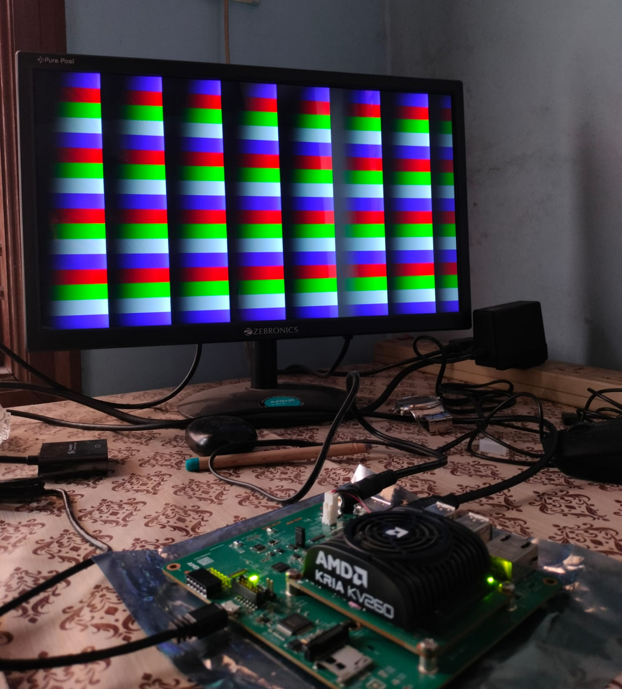
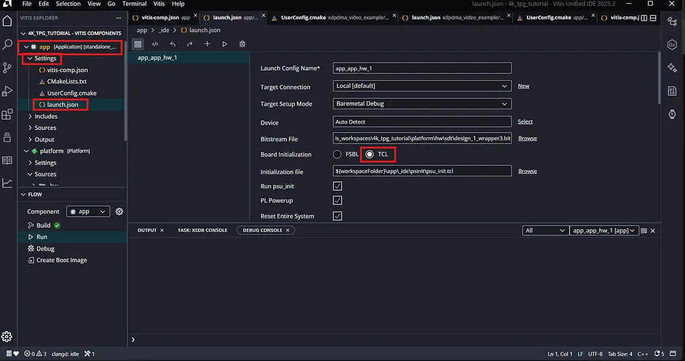
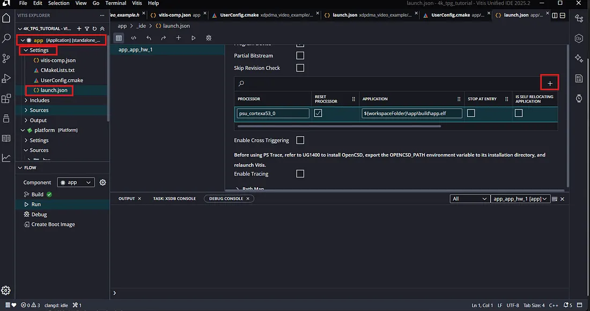
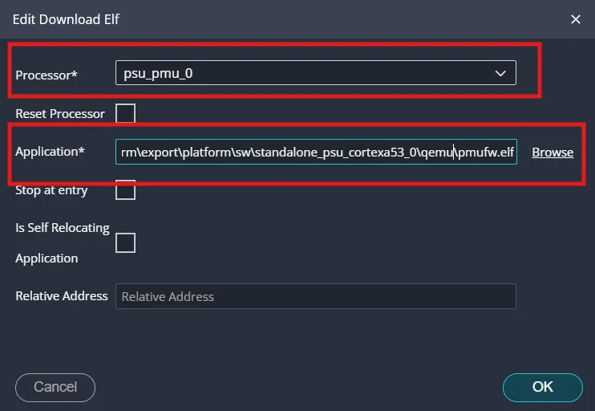
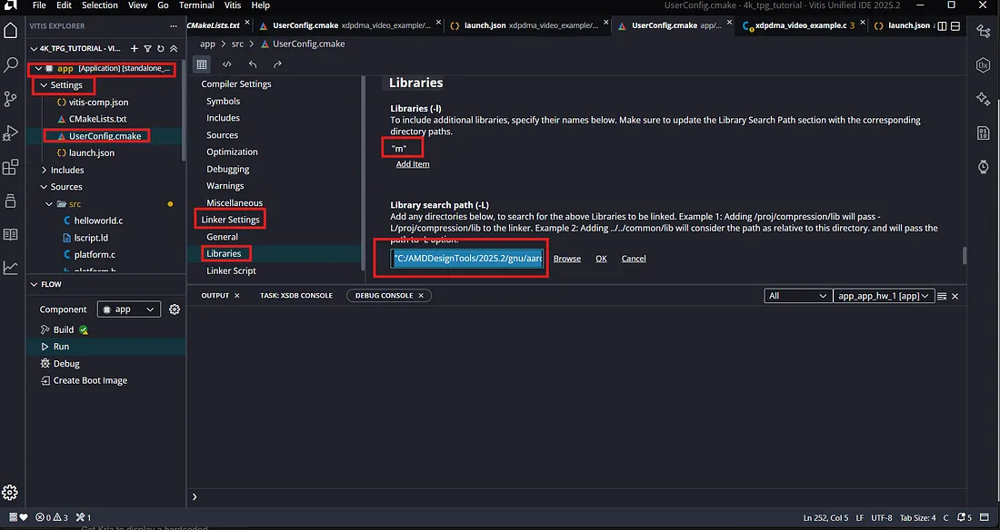

# KV260 DisplayPort Test Pattern (TPG) - bare metal

Bare-metal DisplayPort output on the **AMD Kria KV260** (Vision AI Starter Kit), using the
Zynq UltraScale+ **DPDMA** example from the Vitis BSP, modified so the video pipeline shows the
built-in **Test Pattern Generator (TPG)** instead of the graphics overlay.



## Repository layout

```
.
├── vivado/        Platform: Zynq MPSoC-only design, exported XSA + Tcl rebuild script
├── vitis/         Application sources, UserConfig.cmake, launch.json
├── patches/       The one-line change versus the stock DPDMA example
└── docs/          Screenshots and troubleshooting
```

## Requirements
- AMD Kria **KV260** + **Vision AI Starter Kit** carrier, power supply, USB (JTAG/UART) cable
- DisplayPort monitor (and cable) connected to the KV260 DP port
- Vivado 2024.2 (the committed XSA was created with it) and Vitis Unified IDE (screenshots: 2025.2)
- Boot mode switched to **JTAG** (the application is downloaded over JTAG)

## Quick start (use the committed XSA)
1. Open Vitis, create a workspace.
2. Create a **platform component** named `platform_ps` from `vivado/design_1_wrapper.xsa`
   (OS: standalone, processor: `psu_cortexa53_0`) and **build** it.
3. Open the platform's BSP: *standalone on psu_cortexa53_0 > Drivers > dpdma > Import Examples*
   and import **`xdpdma_video_example`**. The application component opens.
4. Replace the files in the component's `src/` with the ones from
   `vitis/xdpdma_video_example/src/` and fix the library path (see `vitis/README.md`).
5. Replace `_ide/launch.json` with `vitis/xdpdma_video_example/_ide/launch.json`
   (or configure it manually, see step 7 below).
6. **Build** the app, then **Run**.

## Step-by-step (what was done)

### 1-2. Vivado: platform
1. Open Vivado with the KV260 board (carrier: Vision AI Starter Kit connector).
2. Create a project/block design with **only the Zynq UltraScale+ MPSoC** IP.
3. Apply the **board preset**, then remove the dangling master ports (`M_AXI_HPM*`).
4. *Validate Design* > *Generate Output Products* > *Create HDL Wrapper*.
5. *Export Hardware*: **pre-synthesis**, produces the `.xsa`.

Details and the Tcl script: [`vivado/README.md`](vivado/README.md).

### 3-4. Vitis: platform
Create a platform component from the `.xsa` and build it.

### 5. Import the DPDMA example
Platform's BSP > *standalone, Arm Cortex-A53* > **Drivers > dpdma > Open Example Project**
> `xdpdma_video_example`. Opens as an application component.

### 6. Code change (`src/xdpdma_video_example.c`)
```c
// before
XAVBuf_InputVideoSelect(AVBufPtr, XAVBUF_VIDSTREAM1_NONE, XAVBUF_VIDSTREAM2_NONLIVE_GFX);
// after
XAVBuf_InputVideoSelect(AVBufPtr, XAVBUF_VIDSTREAM1_TPG, XAVBUF_VIDSTREAM2_NONE);
```
Diff: [`patches/tpg_input_select.patch`](patches/tpg_input_select.patch)

### 7. `launch.json`: initialise the board with TCL and download the PMU firmware
Reason: the board must be initialised properly so the PL has clocks and signals running before the code starts.

1. *app > Settings > launch.json* > **Board Initialization** = **TCL** (not FSBL).

   

2. Scroll to the **Processor .elf** section and click **+**.

   

3. Processor = `psu_pmu_0`, Application =
   `<workspace>\platform_ps\export\platform_ps\sw\standalone_psu_cortexa53_0\qemu\pmufw.elf`, then OK.
   Tick **Reset Processor** for it.

   

4. **Order matters**: 1) `psu_pmu_0` (pmufw.elf), 2) `psu_cortexa53_0` (the app ELF).

### 8. `UserConfig.cmake`: add the math library
Missing it can cause **silent failures (black screen)**.

*app > Settings > UserConfig.cmake > Linker Settings > Libraries*:
- Libraries (-l): add `"m"` (with the quotes)
- Library search path (-L): your Vitis/AMD design tools path, e.g.
  `C:/AMDDesignTools/2025.2/gnu/aarch64/nt/aarch64-none/aarch64-xilinx-elf/usr/include`



Now **Build** and **Run**. The monitor should show the TPG pattern (photo at the top).

## Troubleshooting
See [`docs/troubleshooting.md`](docs/troubleshooting.md).

## Pre-built full projects
The complete Vivado/Vitis project archives are not stored in git history (they are large and
machine specific). If provided, download them from the **Releases** page of this repository.

## Credits / further reading
This work follows the excellent tutorial by **Velasco**:
[Bare-Metal 4K Streaming on KV260: The 2025.2 Guide (Part 1)](https://medium.com/@velasco622/bare-metal-4k-streaming-on-kv260-the-2025-2-guide-pt-1-91eee4f754fe)
Anyone can follow it to reproduce and extend this setup (including 4K output).

The DPDMA example sources are from AMD/Xilinx (MIT licensed).
